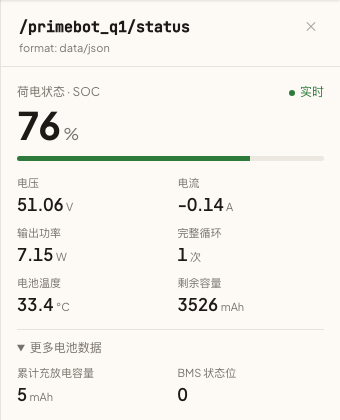

# 启元 Q1 探索版 · 电池状态卡

在[本地 Motus 画布](http://127.0.0.1:15678)添加 **启元 Q1 探索版 → status**，启动后点 **查看数据流**。面板每 0.5 秒刷新一次，并在数据过期时标记「上次读数」。



## 文件入口

| 用途 | 文件 |
| --- | --- |
| 读取真机电池、换算单位 | [robot.py](robot.py) |
| 卡片输出、读数新鲜度、启停 | [status.py](status.py) |
| Motus 注册和配置 | [main.py](main.py) · [driver.yaml](driver.yaml) · [config.yaml](config.yaml) |
| 镜像构建与部署 | [Dockerfile](Dockerfile) · [Linux 部署配置](deploy/service.yml) · [Mac 构建与真机联调](docs/Mac联调.md) |
| 仪表面板与 Core 接入 | [显示组件](frontend/q1-battery.js) · [Core 接入补丁](frontend/core-integration.patch) |
| 集成测试、验证结果与适用范围 | [测试代码](tests/test_status.py) · [验证记录](docs/验证记录.md) |

## 输出字段

数据来自 `/aima/hal/bms/state`（`aimdk_msgs/msg/Bms`）。画布 JSON 的 `battery` 对象包含以下字段。

| 指标 | 字段 | 单位 |
| --- | --- | --- |
| 荷电状态（SOC） | `percentage` | %，直接取自 BMS 剩余容量百分比 |
| 电压、电流、输出功率 | `voltage_v`、`current_a`、`power_w` | V、A、W，电流为负表示放电 |
| 电池温度 | `temperature_c` | °C |
| 剩余容量 | `remaining_capacity_mah` | mAh |
| 完整循环次数 | `cycle_count` | 次 |
| 累计充放电容量 | `cycle_total_capacity_mah` | mAh |
| 厂商电池状态位 | `status_bits` | BMS 原始位掩码 |

`info` 返回卡片状态、输出话题与最近读数。`read` 读取快照，`start` 与 `stop` 控制画布输出。`battery.state` 为 `waiting` 表示等待首个样本，`live` 表示样本在 5 秒以内，`stale` 表示最后读数已过期。`age_s` 给出样本年龄。

## 源码与集成

驱动来自本地 `feat/primebot-q1-driver` 分支的 `0884f82c`。本目录已包含该版本构建所需的公共运行时和启元 `aimdk_msgs` 消息包，可直接作为 Docker 构建上下文。驱动主线见[个人 fork 的 Q1 driver 分支](https://github.com/zichunHU/phanthymotus-driver/tree/feat/primebot-q1-driver/primebot/q1)。[启元官方 SDK 指南](https://github.com/PrimebotTech/primebot-q1-sdk/blob/main/docs/zh/SDK快速入门与集成指南.md)

本机 Core 已集成电池面板。面板对应 Core 分支 `feat/primebot-q1-status-view` 的 `54eb2a9`。在其他基于 `56edda4` 的 Core checkout 中复用时，从本卡片目录设置 `CARD_DIR="$PWD"`，切到目标 Core 根目录后执行：

```bash
git apply "$CARD_DIR/frontend/core-integration.patch"
cp "$CARD_DIR/frontend/q1-battery.js" agent-core/web/js/renderers/
```
